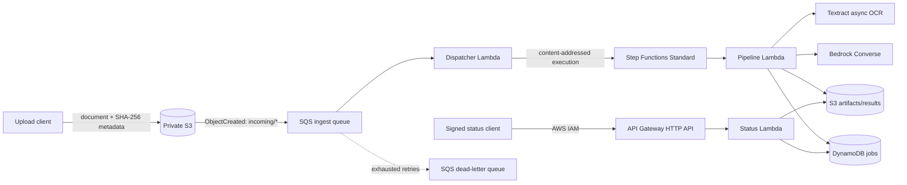

# Cloud-native financial document processing

An event-driven AWS service that accepts financial documents, runs asynchronous OCR, extracts a typed record with an LLM, validates financial fields deterministically, and exposes durable job status through an IAM-authenticated API.

The repository is deliberately serverless: no idle containers, database clusters, NAT gateways, or customer-managed KMS keys. That keeps a portfolio deployment inexpensive while retaining the distributed-systems work—queues, retries, idempotency, workflow state, least-privilege IAM, observability, and teardown.

## Architecture



### Processing contract

1. `scripts/upload.py` calculates SHA-256, uploads under `incoming/<digest>/`, and prints the digest as `job_id`.
2. S3 sends an event to SQS. The dispatcher streams the object, enforces the 20 MiB default limit, verifies optional `sha256` metadata, and starts `doc-<job_id>`.
3. A Standard Step Functions execution starts Textract with the same digest as its `ClientRequestToken`, polls without holding Lambda compute, and stores paginated OCR blocks in S3.
4. Bedrock Converse forces a `record_financial_document` tool call. Deterministic code then validates dates, currency, amount, parties, confidence, and source evidence.
5. The canonical result uses a decimal string for `total_amount`; JSON floating-point conversion never silently changes a financial value.
6. DynamoDB records each state transition. `GET /jobs/{job_id}` returns status and, when complete, the result.

## Reliability model

| Failure | Behavior |
|---|---|
| Duplicate S3 event or repeated upload | SHA-256 execution name deduplicates for 90 days; a completed DynamoDB job prevents reprocessing after that window. |
| Dispatcher timeout or transient AWS error | SQS retries only the failed batch items. Five failed receives route the message to the DLQ. |
| Lost response while starting OCR | Textract `ClientRequestToken` makes the start operation idempotent. |
| Textract still running | Step Functions waits five seconds and polls again. No Lambda remains active. |
| Lambda service failure | Step Functions retries four times with exponential backoff. |
| Replayed extraction task | Existing S3 extraction output is reused before another model call. A failure between model response and S3 persistence can still produce one extra billed call. |
| Terminal task failure | The job becomes `FAILED`, a custom metric is emitted, and the workflow ends in a failed state. |

## Security and data handling

- S3 public access is blocked; ACLs are disabled; TLS is mandatory; objects use SSE-S3 encryption.
- SQS uses managed encryption. DynamoDB encryption and point-in-time recovery are enabled.
- Each Lambda and Step Functions role has a separate scoped policy. The two Textract actions and CloudWatch log-delivery APIs require `Resource: "*"` because those APIs do not support resource-level permissions.
- The status route uses `AWS_IAM`. Attach the output `status_api_caller_policy_arn` only to readers that need access.
- Step Functions execution-data logging is disabled. Application logs contain identifiers and state changes, not OCR text or extracted document content.
- S3 objects and DynamoDB jobs expire after 30 days by default. CloudWatch logs expire after 14 days.
- This is an engineering portfolio system, not a claim of PCI DSS, SOC 2, GDPR, or banking-regulatory compliance.

SSE-S3 is intentional for the development environment: it provides encryption at rest without a standing KMS key charge. A regulated deployment would normally use a customer-managed key, key rotation, access auditing, and explicit data-residency controls.

## Prerequisites

- AWS credentials with permission to create the declared resources
- Amazon Bedrock access to `amazon.nova-lite-v1:0` in `us-east-1`, or a compatible model supplied through `bedrock_model_id`
- Terraform 1.10 or newer
- Python 3.14 and [uv](https://docs.astral.sh/uv/)

The Lambda runtime supplies Boto3; the development group pins Boto3 for local tests and clients.

## Local checks

```bash
uv sync
uv run ruff format --check .
uv run ruff check .
uv run pytest --cov=financial_document_processor --cov-report=term-missing

terraform -chdir=infra init -backend=false
terraform -chdir=infra fmt -check
terraform -chdir=infra validate
```

## Deploy

Start with a sandbox AWS account. Add a real email address so the deployment creates 80% forecast and 100% actual monthly budget notifications plus operational alarm notifications.

```bash
cp infra/terraform.tfvars.example infra/terraform.tfvars
# Edit alarm_email before continuing.
terraform -chdir=infra init
terraform -chdir=infra plan -out=tfplan
terraform -chdir=infra apply tfplan
```

Confirm the SNS subscription email. Budget notifications can be delayed; they are not a hard spending cap.

Capture the outputs:

```bash
BUCKET=$(terraform -chdir=infra output -raw documents_bucket)
API_URL=$(terraform -chdir=infra output -raw status_api_url)
```

## Process a document

Supported uploads: PDF, PNG, JPEG, and TIFF.

```bash
uv run python scripts/upload.py sample-invoice.pdf --bucket "$BUCKET" --region us-east-1
```

Use the printed `job_id`:

```bash
uv run python scripts/status.py <job_id> --api-url "$API_URL" --region us-east-1
```

The caller needs `execute-api:Invoke` on the route. Terraform outputs a ready-to-attach IAM policy ARN. Administrator credentials already have that permission in a typical sandbox, but should not be used by an application.

## Operations

The `financial-docs-dev-pipeline` CloudWatch dashboard tracks queued, completed, failed, and duplicate documents; average processing time; token usage; and ingest/DLQ depth. Alarms cover a non-empty DLQ, processing Lambda errors, and failed state-machine executions.

Useful failure exercise:

1. Upload a valid document.
2. Temporarily set the pipeline Lambda reserved concurrency to zero while the workflow is running.
3. Observe Step Functions retries and CloudWatch Lambda errors.
4. Restore concurrency and verify the same `job_id` completes without a duplicate Textract job.

Do not run that exercise against production or while unrelated workloads share the function.

## Teardown

```bash
terraform -chdir=infra destroy
```

The development bucket uses `force_destroy = true`, so this explicit command deletes its object versions. Preserve benchmark results outside the deployment first.

## Current boundaries

- One document per job; no multi-tenant authorization model.
- OCR extracts `LINE` blocks, not Textract tables/forms or native PDF text.
- Bedrock input is capped at 120,000 OCR characters; truncation is visible in result warnings.
- The status API returns the complete result and is therefore intentionally IAM-only.
- No cloud resources are required for local tests; AWS behavior is exercised after deployment through the upload and status clients.

## References

- [AWS: asynchronous Textract processing](https://docs.aws.amazon.com/textract/latest/dg/async.html)
- [AWS: Step Functions Standard execution idempotency](https://docs.aws.amazon.com/step-functions/latest/apireference/API_StartExecution.html)
- [AWS: Bedrock Converse API](https://docs.aws.amazon.com/bedrock/latest/userguide/conversation-inference.html)
